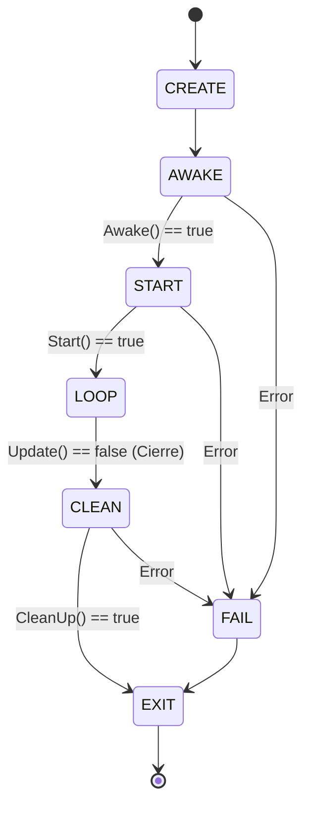
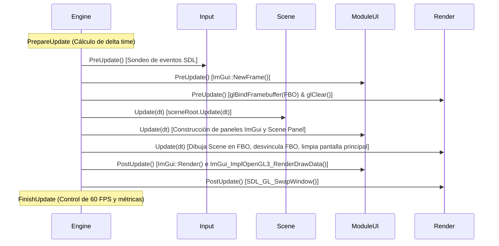
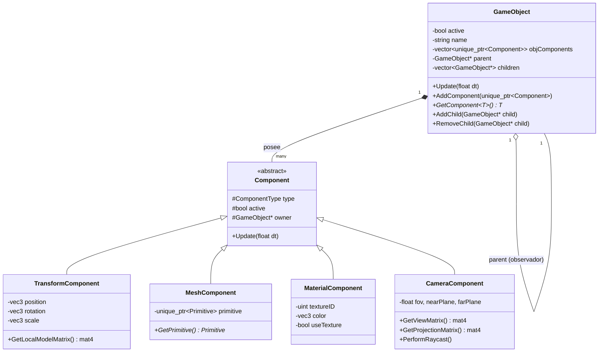

# Arquitectura y Funcionamiento del Motor: Escena, UI y Pipeline Gráfico

Este documento proporciona una radiografía técnica exhaustiva del motor de videojuegos, explicando en detalle el diseño de la arquitectura modular, cómo y dónde se crean y gestionan las escenas, el funcionamiento del sistema de entidades y componentes (ECS básico), la integración completa de Dear ImGui con SDL3 y OpenGL, y el flujo de renderizado *Off-Screen* mediante Framebuffers (FBO).

---

## 1. Visión General de la Arquitectura del Motor

El motor implementa una arquitectura modular desacoplada basada en el patrón **Application / Modules**, orquestada a través de un **Singleton** central (`Engine`) y una máquina de estados finita en el punto de entrada.

### 1.1 Punto de Entrada y Máquina de Estados (`main.cpp`)

El flujo de vida de la aplicación se controla en [Source/main.cpp](file:///c:/Users/ruben/Documents/GitHub/MotorVideojuego/Source/main.cpp). En lugar de ejecutar un bucle directo, la ejecución se modela como una máquina de estados:



* **`CREATE`**: Instancia inicial.
* **`AWAKE`**: Inicializa subsistemas básicos antes de que el contexto gráfico o la ventana estén completamente disponibles.
* **`START`**: Configura recursos iniciales, geometrías, cámaras y el estado inicial de la escena.
* **`LOOP`**: Itera frame a frame ejecutando el método `Engine::Update()`.
* **`CLEAN`**: Libera todos los recursos en orden inverso de inicialización.

---

### 1.2 El Orquestador Central: `Engine` y los `Module`

La clase [Engine](file:///c:/Users/ruben/Documents/GitHub/MotorVideojuego/Source/Engine/Engine.h) ([Engine.cpp](file:///c:/Users/ruben/Documents/GitHub/MotorVideojuego/Source/Engine/Engine.cpp)) administra una lista polimórfica de módulos derivados de [Module](file:///c:/Users/ruben/Documents/GitHub/MotorVideojuego/Source/Engine/Module.h):

```cpp
class Module {
public:
    virtual bool Awake() { return true; }
    virtual bool Start() { return true; }
    virtual bool PreUpdate() { return true; }
    virtual bool Update(float dt) { return true; }
    virtual bool PostUpdate() { return true; }
    virtual bool CleanUp() { return true; }
};
```

#### Orden de Registro de Módulos (Constructor de `Engine`):
En [Engine.cpp#L42-L51](file:///c:/Users/ruben/Documents/GitHub/MotorVideojuego/Source/Engine/Engine.cpp#L42-L51):
1. **`Window`**: Maneja la ventana SDL3 y el contexto de OpenGL.
2. **`Input`**: Captura teclado, ratón, gamepads y eventos de drag-and-drop de archivos.
3. **`Audio`**: Subsistema de audio.
4. **`Scene`**: Gestor de jerarquía de la escena, entidades y componentes.
5. **`UI` (`ModuleUI`)**: Editor ImGui, ventanas de docking, inspector y jerarquía.
6. **`Render`**: Pipeline de renderizado, shaders, FBO y primitivas de OpenGL.

#### El Ciclo de un Frame (`Engine::Update()`):
Cada frame ejecuta cuatro fases secuenciales:



---

## 2. Creación y Gestión de Escenas

La gestión de la escena reside en la clase [Scene](file:///c:/Users/ruben/Documents/GitHub/MotorVideojuego/Source/Engine/Scene/Scene.h) y [Scene.cpp](file:///c:/Users/ruben/Documents/GitHub/MotorVideojuego/Source/Engine/Scene/Scene.cpp).

### 2.1 Estructura Interna de `Scene`

En [Scene.h#L38-L41](file:///c:/Users/ruben/Documents/GitHub/MotorVideojuego/Source/Engine/Scene/Scene.h#L38-L41):
```cpp
private:
    GameObject sceneRoot;
    std::vector<std::unique_ptr<GameObject>> sceneEntities;
    GameObject* mainCameraPtr;
```

* **`sceneRoot`**: Es un `GameObject` creado por valor que actúa como la raíz invisible de todo el árbol de la escena. Todo actor visible o funcional de la escena es, directa o indirectamente, hijo de `sceneRoot`.
* **`sceneEntities`**: Un vector de punteros inteligentes `std::unique_ptr<GameObject>`. **Este vector es el dueño absoluto de la memoria dinámica** de los GameObjects de la escena. Garantiza que cuando `Scene` se destruya, todos los objetos se liberen automáticamente sin memory leaks.
* **`mainCameraPtr`**: Puntero sin propiedad (observador) que apunta al `GameObject` que contiene el componente de cámara activo (`EditorCamera`). Permite un acceso $O(1)$ sin búsquedas en el árbol.

---

### 2.2 ¿Dónde se crean los objetos de la Escena?

Los objetos de la escena se crean en dos lugares específicos:

#### A. Inicialización Inicial: `Scene::Start()`
En [Scene.cpp#L34-L87](file:///c:/Users/ruben/Documents/GitHub/MotorVideojuego/Source/Engine/Scene/Scene.cpp#L34-L87), al arrancar el motor se instancian los siguientes objetos:

1. **`EditorCamera`**:
   - Componentes:
     - `TransformComponent`: Posición inicial en $(0.0, 1.0, 5.0)$.
     - `CameraComponent`: Control de proyección en perspectiva, matriz de vista y raycasting.
   - Registro:
     ```cpp
     mainCameraPtr = camObj.get();
     sceneRoot.AddChild(camObj.get());
     sceneEntities.push_back(std::move(camObj));
     ```
2. **`Cube`**:
   - `TransformComponent`: Posición inicial $(-2.0, 0.0, 0.0)$.
   - `MeshComponent`: Generado con `GeometryGenerator::CreateCube(1.0f)`.
   - `MaterialComponent`: Color rojo $(1.0, 0.2, 0.2)$, `useTexture = false`.
   - Añadido como hijo de `sceneRoot` y almacenado en `sceneEntities`.
3. **`Sphere`**:
   - `TransformComponent`: Posición inicial $(2.0, 0.0, 0.0)$.
   - `MeshComponent`: Generado con `GeometryGenerator::CreateSphere(0.5f, 20, 20)`.
   - `MaterialComponent`: Color blanco $(1.0, 1.0, 1.0)$, textura cargada desde `"../test.jpg"`, `useTexture = true`.
   - Añadido como hijo de `sceneRoot` y almacenado en `sceneEntities`.

#### B. Creación Dinámica: `Scene::CreateNewGameObject()`
En [Scene.cpp#L120-L162](file:///c:/Users/ruben/Documents/GitHub/MotorVideojuego/Source/Engine/Scene/Scene.cpp#L120-L162):
```cpp
void Scene::CreateNewGameObject(vector<std::unique_ptr<Component>> objComponents);
```
Este método permite inyectar nuevas entidades en caliente (por ejemplo, al importar modelos 3D con Drag & Drop):
1. Crea un nuevo `std::unique_ptr<GameObject>`.
2. Asigna los componentes transferidos mediante `std::move`.
3. **Garantiza componentes obligatorios**: Si el usuario no pasó un `TransformComponent`, `MeshComponent` o `MaterialComponent`, la función crea automáticamente componentes con valores por defecto.
4. Vincula el objeto a la jerarquía (`sceneRoot.AddChild(newObj.get())`).
5. Transfiere la propiedad al contenedor principal (`sceneEntities.push_back(std::move(newObj))`).

---

### 2.3 Estructura de `GameObject` y Jerarquía Espacial

La clase [GameObject](file:///c:/Users/ruben/Documents/GitHub/MotorVideojuego/Source/Engine/Scene/GameObjects/GameObject.h) implementa una arquitectura híbrida Entidad-Contenedor:



#### Reglas de Posesión y Punteros:
* **Posesión Fuerte (`std::unique_ptr`)**: Cada `GameObject` es dueño de sus componentes (`objComponents`). Nadie más puede destruirlos ni compartirlos.
* **Punteros Débiles / Observadores (`raw pointer`)**: Las relaciones `parent` y `children` utilizan punteros estándar `GameObject*`. El padre **no** es dueño de la memoria del hijo (el dueño es `Scene::sceneEntities`), lo que evita problemas de destrucción doble o punteros colgantes en reasignaciones de jerarquía.
* **Desvinculación Segura**:
  ```cpp
  void GameObject::AddChild(GameObject* child) {
      if (child->parent) {
          child->parent->RemoveChild(child);
      }
      child->parent = this;
      children.push_back(child);
  }
  ```

---

## 3. Implementación de la Interfaz de Usuario (UI) con Dear ImGui

El subsistema de interfaz está encapsulado en [ModuleUI.h](file:///c:/Users/ruben/Documents/GitHub/MotorVideojuego/Source/Engine/UI/ModuleUI.h) y [ModuleUI.cpp](file:///c:/Users/ruben/Documents/GitHub/MotorVideojuego/Source/Engine/UI/ModuleUI.cpp).

### 3.1 Inicialización de ImGui (`ModuleUI::Start`)
En [ModuleUI.cpp#L37-L64](file:///c:/Users/ruben/Documents/GitHub/MotorVideojuego/Source/Engine/UI/ModuleUI.cpp#L37-L64):
* **Configuración de Flags**:
  - `ImGuiConfigFlags_DockingEnable`: Habilita el acoplamiento libre de pestañas y paneles al estilo de Unreal Engine o Unity.
  - `ImGuiConfigFlags_ViewportsEnable`: Permite arrastrar ventanas de ImGui fuera de la ventana de SDL3 a los monitores del sistema operativo como ventanas flotantes independientes.
* **Integración de Backends**:
  - `ImGui_ImplSDL3_InitForOpenGL`: Conecta los eventos de ventana, ratón y teclado de SDL3 con el sistema de input de ImGui.
  - `ImGui_ImplOpenGL3_Init("#version 130")`: Configura el compilador de shaders de ImGui para el renderizado de primitivas 2D en OpenGL.

### 3.2 Layout Fijo del Editor con `ImGui::DockBuilder`
Para evitar que las ventanas se generen amontonadas o en un punto fijo arbitrario al iniciar por primera vez (o al borrar `imgui.ini`), se utiliza la API interna `<imgui_internal.h>` con `ImGui::DockBuilder`:
* Se evalúa si el `DockSpace` principal está inicializado o si el usuario solicita resetearlo desde el menú superior `Window -> Reset Layout`.
* Se subdivide la pantalla de forma automática:
  - **Izquierda (20%)**: Nodo acoplado para `Hierarchy`.
  - **Centro Superior (52%)**: Nodo central principal para el viewport de `Scene`.
  - **Centro Inferior (30% altura)**: Nodo para el panel `Console`.
  - **Derecha (28%)**: Nodo superior para `Inspector` y nodo inferior para `Render Settings`.

---

### 3.3 Los Paneles del Editor

#### 1. Panel "Scene" (Viewport 3D)
En [ModuleUI.cpp#L150-L188](file:///c:/Users/ruben/Documents/GitHub/MotorVideojuego/Source/Engine/UI/ModuleUI.cpp#L150-L188):
* Dibuja la escena 3D renderizada en el FBO redimensionado dinámicamente según `ImGui::GetContentRegionAvail()`.
* Proporciona selección mediante Raycast 3D (`camComp->PerformRaycast()`).

#### 2. Panel "Hierarchy" (Árbol de Escena)
En [ModuleUI.cpp#L190-L215](file:///c:/Users/ruben/Documents/GitHub/MotorVideojuego/Source/Engine/UI/ModuleUI.cpp#L190-L215):
* Barra superior con botón rápido de deselección.
* Recorrido recursivo del árbol con `ImGui::TreeNodeEx` y sincronización bidireccional con la cámara.

#### 3. Panel "Inspector" (Propiedades del Objeto Seleccionado)
En [ModuleUI.cpp#L217-L295](file:///c:/Users/ruben/Documents/GitHub/MotorVideojuego/Source/Engine/UI/ModuleUI.cpp#L217-L295):
* `TransformComponent`: tabla alineada de 2 columnas con `Position`, `Rotation` y `Scale`.
* `MeshComponent`: estado de la geometría cargada en GPU.
* `MaterialComponent`: selector de color con rueda HUE, switch de textura y TextureID.

#### 4. Panel "Render Settings" (Opciones Gráficas)
En [ModuleUI.cpp#L297-L308](file:///c:/Users/ruben/Documents/GitHub/MotorVideojuego/Source/Engine/UI/ModuleUI.cpp#L297-L308):
* Checkboxes directos para Depth Test, Cull Face, Lighting y Wireframe Mode.

#### 5. Panel "Console" (Sistema de Logging y Diagnóstico)
En [ModuleUI.cpp](file:///c:/Users/ruben/Documents/GitHub/MotorVideojuego/Source/Engine/UI/ModuleUI.cpp):
* **Filtros por categoría**: Botones toggle con contadores interactivos para `[i] Info (X)`, `[!] Warnings (Y)` y `[X] Errors (Z)`.
* **Filtro de búsqueda**: Campo interactivo para filtrar logs por texto o palabras clave en tiempo real.
* **Agrupación (`Collapse`)**: Agrupa mensajes idénticos consecutivos mostrando un badge `[xN]`.
* **Auto-scroll**: Desplazamiento automático al final cuando entran nuevos logs.
* **Panel de Detalles**: Al hacer clic en un mensaje, se despliega una vista inferior con la traza completa, origen (`fichero:línea`) y botón "Copiar Mensaje" al portapapeles (`ImGui::SetClipboardText`).
* **Desacoplamiento total**: El motor emite eventos mediante `LOG(...)`, `LOG_WARNING(...)`, `LOG_ERROR(...)` o `Log()`, `Warning()`, `Error()` sin depender de ImGui.

#### 6. Panel "Configuration" (Monitorización de Rendimiento, Módulos y Hardware)
En [ModuleUI.cpp#L613-L1015](file:///c:/Users/ruben/Documents/GitHub/MotorVideojuego/Source/Engine/UI/ModuleUI.cpp#L613-L1015):
Organizado en 7 pestañas mediante `ImGui::BeginTabBar`:
1. **Application (Rendimiento)**:
   * **Gráficos en tiempo real**: Histograma continuo de FPS (0 a 140) y de tiempo de procesamiento por frame en milisegundos (`ms`, 0 a 35 ms) mediante buffers circulares sin sobrecoste de asignación dinámica (`PerformanceData::HISTORY_CAPACITY = 100`).
   * **Métricas estadísticas**: Registro de valores Mínimo, Máximo, Promedio y Actual tanto para FPS como para tiempo de frame (ms).
   * **Control de framerate**: Slider interactivo de límite de FPS (0 a 240, 0 = Ilimitado) y control de V-Sync en tiempo real.
   * **Memoria y Uptime**: Contador de tiempo de ejecución, frames acumulados y consumo de memoria RAM del proceso (Working Set y Peak Working Set en MB).
2. **Window**:
   * Modificación en vivo del título de ventana (`SDL_SetWindowTitle`).
   * Redimensión interactiva con validación (mínimo 640x480, máximo 3840x2160) y botón para restablecer.
   * Toggles en tiempo real: Pantalla Completa (`SetFullscreen`), Ventana Redimensionable (`SetResizable`) y Sin Bordes (`SetBorderless`).
   * Distinción visual clara de parámetros de solo lectura `[Requiere Reinicio]` (Contexto OpenGL 4.6, 24-bit Depth, 8-bit Stencil, Double Buffering).
3. **Renderer**:
   * Checkboxes en tiempo real: V-Sync (`SDL_GL_SetSwapInterval`), Depth Test, Face Culling, Lighting y Wireframe Mode.
   * Selector dinámico de Color de Fondo (Clear Color) mediante `ImGui::ColorEdit3`.
   * Telemetría del Framebuffer: resolución actual del Viewport, IDs de FBO, textura de color y RBO, y estado de completitud OpenGL.
4. **Input**:
   * Mouse: posición absoluta $(X, Y)$, delta de movimiento $(\Delta X, \Delta Y)$, rueda de desplazamiento (scroll) y estado en vivo de botones (Izquierdo, Central, Derecho).
   * Gamepad: estado de conexión, sticks analógicos y gatillos LT/RT.
   * Drag & Drop: visualización de la ruta del archivo recientemente soltado en la ventana.
5. **Textures**:
   * Versión interna de DevIL (`IL_VERSION_NUM`) y formatos compatibles (PNG, JPG, DDS, TGA, BMP).
   * Configuración de filtrado por defecto para nuevas texturas (Minificación, Magnificación, Wrap S/T).
   * Explicación de persistencia de texturas en VRAM `[Requiere Reinicio]`.
6. **Audio**:
   * Sliders de control en tiempo real para Volumen Maestro de Música (0-100%) y Efectos SFX (0-100%).
   * Información del driver de audio SDL3.
7. **Hardware**:
   * **CPU**: núcleos lógicos (`SDL_GetNumLogicalCPUCores`), memoria RAM del sistema en MB/GB, tamaño de línea de caché e instrucciones vectoriales (AVX, AVX2, AVX512, SSE, SSE2, SSE3, SSE4.1, SSE4.2) con indicadores coloreados.
   * **GPU**: fabricante (`GL_VENDOR`), modelo (`GL_RENDERER`), driver (`GL_VERSION`), GLSL (`GL_SHADING_LANGUAGE_VERSION`), límites de resolución de textura y viewport, y memoria VRAM dedicada/disponible (mediante extensiones NVX/ATI).
   * **Memoria del proceso**: Working Set y Peak Working Set en MB mediante `GetProcessMemoryInfo`.
   * **Bibliotecas**: versiones de SDL3, OpenGL, DevIL, Assimp y Dear ImGui.

---

### 3.4 Sistema Centralizado de Registro (`LogSystem`)
Definido en [Source/Utils/Log.h](file:///c:/Users/ruben/Documents/GitHub/MotorVideojuego/Source/Utils/Log.h) y [Source/Utils/Log.cpp](file:///c:/Utils/Log.cpp):
* **Thread-safe**: Utiliza `std::mutex` para permitir llamadas seguras desde cualquier subsistema.
* **Timestamps automáticos**: Extrae la hora local en formato `HH:MM:SS`.
* **Límite de memoria**: Buffer circular de hasta 2000 mensajes para evitar saturación de RAM.
* **Salida dual**: Envía los logs simultáneamente a la consola del editor, a la terminal estándar (`std::cout`) y al debugger (`OutputDebugStringA`).

### 3.5 Cobertura de Logs por Subsistema (Diagnóstico y Monitoreo)

| Subsistema / Librería | Eventos Monitorizados | Nivel de Log | Archivo Fuente |
| :--- | :--- | :--- | :--- |
| **SDL3** | Inicialización del subsistema de video, versión de SDL (`SDL_GetVersion`), creación y banderas de la ventana nativa. Errores críticos de creación de ventana. | `[INFO]` / `[ERR ]` | [Window.cpp](file:///c:/Users/ruben/Documents/GitHub/MotorVideojuego/Source/Engine/Window/Window.cpp) |
| **OpenGL & GLAD** | Creación de contexto 4.6 Core Profile, carga de punteros GLAD, volcados de hardware (`GL_RENDERER`, `GL_VENDOR`, `GL_VERSION`, `GL_SHADING_LANGUAGE_VERSION`), compilación de Vertex/Fragment Shaders (`glGetShaderInfoLog`), enlazado del Shader Program y creación de FBO. | `[INFO]` / `[ERR ]` | [Window.cpp](file:///c:/Users/ruben/Documents/GitHub/MotorVideojuego/Source/Engine/Window/Window.cpp), [Render.cpp](file:///c:/Users/ruben/Documents/GitHub/MotorVideojuego/Source/Engine/Render/Render.cpp) |
| **Assimp** | Versión de la librería (`aiGetVersionMajor/Minor/Revision`), inicio de carga de geometría, estadísticas de escena (mallas, materiales, texturas embebidas), detalle de sub-mallas (vértices, caras, verificación de normales y coordenadas UV), y errores con `importer.GetErrorString()`. | `[INFO]` / `[ERR ]` | [ModelLoader.cpp](file:///c:/Users/ruben/Documents/GitHub/MotorVideojuego/Source/Engine/Render/3DModels/ModelLoader.cpp) |
| **DevIL** | Inicialización con versión interna (`IL_VERSION_NUM`), carga de texturas con resolución, bpp y OpenGL Texture ID, y reporte de errores detallados con código numérico de error (`ilGetError()`). | `[INFO]` / `[ERR ]` | [TextureLoader.h](file:///c:/Users/ruben/Documents/GitHub/MotorVideojuego/Source/Engine/Render/Texture/TextureLoader.h) |
| **Dear ImGui** | Versión (`IMGUI_VERSION`), backends inicializados (SDL3 + OpenGL3), flags de docking y ciclo de vida (Start / CleanUp). | `[INFO]` | [ModuleUI.cpp](file:///c:/Users/ruben/Documents/GitHub/MotorVideojuego/Source/Engine/UI/ModuleUI.cpp) |
| **Drag & Drop** | Detección de modelos (`.fbx`, `.obj`) e instanciación de nuevos GameObjects con `MeshComponent`. Detección de texturas (`.png`, `.jpg`, `.dds`, etc.) y asignación al GameObject seleccionado con advertencias si no hay selección o falta `MaterialComponent`. | `[INFO]` / `[WARN]` | [Render.cpp](file:///c:/Users/ruben/Documents/GitHub/MotorVideojuego/Source/Engine/Render/Render.cpp), [ModuleUI.cpp](file:///c:/Users/ruben/Documents/GitHub/MotorVideojuego/Source/Engine/UI/ModuleUI.cpp) |
| **Flow & Ciclo de Vida** | Transición entre estados principales del motor (`CREATE`, `AWAKE`, `START`, `UPDATE`, `CLEANUP`, `EXIT`), iteración y tiempos de ejecución por módulo, e instanciación de entidades de escena (`EditorCamera`, `Cube`, `Sphere`). | `[INFO]` / `[ERR ]` | [main.cpp](file:///c:/Users/ruben/Documents/GitHub/MotorVideojuego/Source/main.cpp), [Engine.cpp](file:///c:/Users/ruben/Documents/GitHub/MotorVideojuego/Source/Engine/Engine.cpp), [Scene.cpp](file:///c:/Users/ruben/Documents/GitHub/MotorVideojuego/Source/Engine/Scene/Scene.cpp) |

---

## 4. Pipeline de Renderizado y Flujo FBO (Off-Screen Rendering)

El módulo [Render](file:///c:/Users/ruben/Documents/GitHub/MotorVideojuego/Source/Engine/Render/Render.h) ([Render.cpp](file:///c:/Users/ruben/Documents/GitHub/MotorVideojuego/Source/Engine/Render/Render.cpp)) es el ejecutor gráfico del motor.

### 4.1 Creación del Framebuffer (`Render::CreateFramebuffer`)
En [Render.cpp#L125-L150](file:///c:/Users/ruben/Documents/GitHub/MotorVideojuego/Source/Engine/Render/Render.cpp#L125-L150):
1. Se crea un Framebuffer Object (`framebuffer`).
2. Se crea una textura 2D (`textureColorbuffer`) de tamaño $(W, H)$ y formato `GL_RGB`. Se vincula al slot `GL_COLOR_ATTACHMENT0` del FBO.
3. Se crea un Renderbuffer Object (`rbo`) con formato `GL_DEPTH24_STENCIL8` y se vincula al slot `GL_DEPTH_STENCIL_ATTACHMENT` para permitir el cálculo de profundidad (Depth Buffer).

### 4.2 Flujo Paso a Paso en Cada Frame

```
[Inicio de Frame]
   │
   ├─► 1. Render::PreUpdate()
   │      - glBindFramebuffer(GL_FRAMEBUFFER, framebuffer);
   │      - glClear(GL_COLOR_BUFFER_BIT | GL_DEPTH_BUFFER_BIT);
   │      (El lienzo FBO queda limpio y listo para recibir gráficos 3D)
   │
   ├─► 2. Render::Update()
   │      - Configura estados: Depth Test, Cull Face, Wireframe Mode.
   │      - Activa shaderProgram.
   │      - Pasa matrices View y Projection desde la CameraComponent activa.
   │      - DrawGameObject(sceneRoot):
   │          * Multiplica: WorldMatrix = ParentMatrix * LocalMatrix.
   │          * Dibuja mallas vinculando texturas y colores.
   │          * Llama recursivamente a los hijos con su WorldMatrix acumulada.
   │      - glBindFramebuffer(GL_FRAMEBUFFER, 0); // Desvincula el FBO
   │      - Limpia la pantalla nativa con color gris oscuro (0.1, 0.1, 0.1).
   │
   ├─► 3. ModuleUI::Update()
   │      - Construye el layout con DockSpace.
   │      - En el panel "Scene": ImGui::Image(textureColorbuffer).
   │      - En el panel "Hierarchy": ImGui::TreeNodeEx().
   │      - En el panel "Inspector": DragFloat3, ColorPicker3.
   │
   ├─► 4. ModuleUI::PostUpdate()
   │      - ImGui::Render();
   │      - ImGui_ImplOpenGL3_RenderDrawData(ImGui::GetDrawData());
   │      - ImGui::UpdatePlatformWindows() (para multi-viewport).
   │
   └─► 5. Render::PostUpdate()
          - SDL_GL_SwapWindow(window);
          (Presenta la imagen final compuesta en el monitor)
```

### 4.3 Cálculo Matemático de Matrices en la Jerarquía
En [Render.cpp#L274-L278](file:///c:/Users/ruben/Documents/GitHub/MotorVideojuego/Source/Engine/Render/Render.cpp#L274-L278):
Para cada `GameObject`, su matriz local se genera en [TransformComponent.h#L24-L33](file:///c:/Users/ruben/Documents/GitHub/MotorVideojuego/Source/Engine/Scene/GameObjects/Components/TransformComponent.h#L24-L33):
$$M_{\text{local}} = T(p) \cdot R_x(\theta_x) \cdot R_y(\theta_y) \cdot R_z(\theta_z) \cdot S(s)$$
Y en la función recursiva `DrawGameObject`:
$$M_{\text{global}} = M_{\text{parent}} \cdot M_{\text{local}}$$
Esta matriz acumulada se pasa al uniform `model` en el vertex shader:
$$\text{gl\_Position} = \text{Projection} \cdot \text{View} \cdot M_{\text{global}} \cdot \begin{pmatrix} x \\ y \\ z \\ 1 \end{pmatrix}$$

---

## 5. Resumen de Puntos Clave y Recomendaciones de Evolución

| Área | Implementación Actual | Oportunidad de Mejora / Siguiente Paso |
| :--- | :--- | :--- |
| **Escena** | Monolítica en `Scene` con `sceneRoot` fija. | Crear una clase `Scene` instanciable (para permitir cambiar de niveles o escenas) y un `SceneManager`. |
| **Búsqueda de Componentes** | `dynamic_cast<T*>` recursivo en vector. | Cambiar a IDs de tipo o bitsets (`std::type_index`) para eliminar el costo de RTTI en búsquedas frame a frame. |
| **Resolución del Viewport** | FBO redimensionado dinámicamente y aspect ratio sincronizado con `viewportSize` de ImGui. | **Implementado**: Los GameObjects ya no se deforman al redimensionar el panel Scene. |
| **Importación de Assets** | `Render::ImportModel()` en `Render.cpp`. | Mover la lógica de carga a un subsistema dedicado `ResourceManager` o `AssetLoader` para desacoplar el renderizado de la E/S de archivos. |
| **Detección de Selección** | Raycast con intersección matemática rayo-esfera (`RaySphereIntersection`). | Implementar selección por color buffer (ID picking en un canal de render) o Ray-AABB / Ray-OBB para mayor precisión en mallas complejas. |
